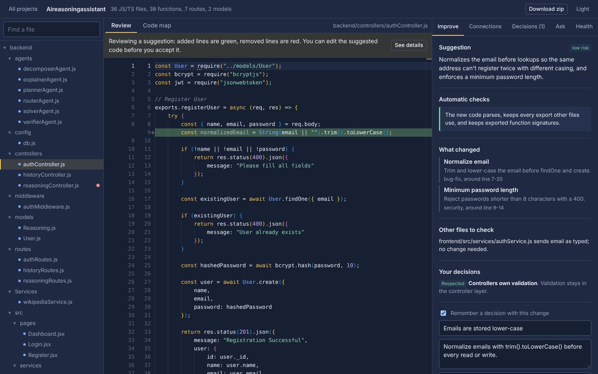
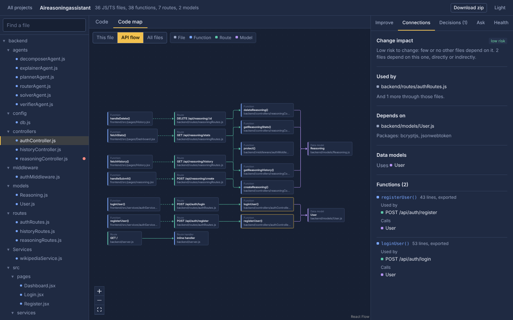
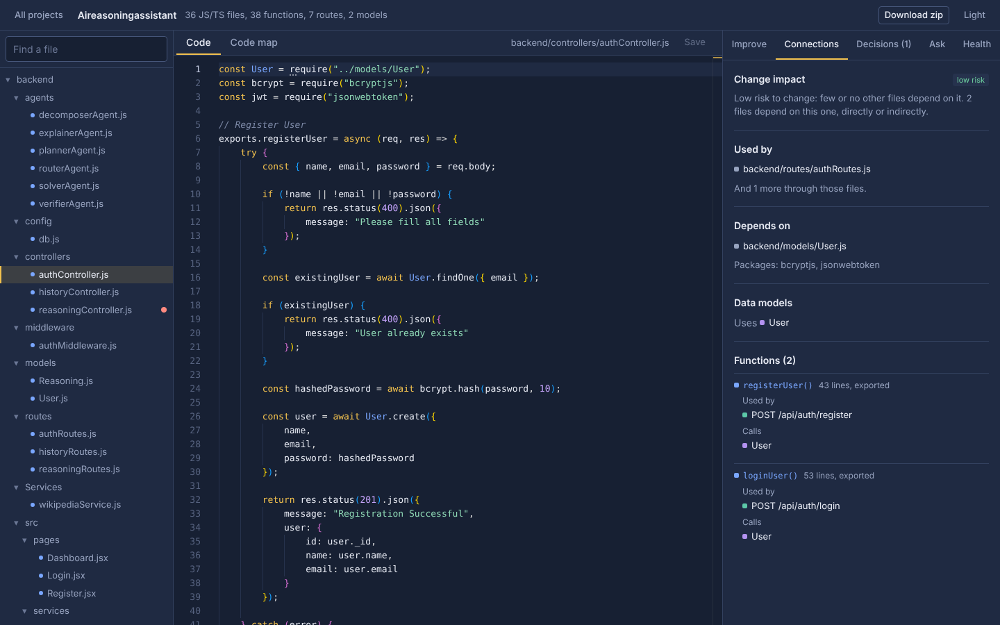
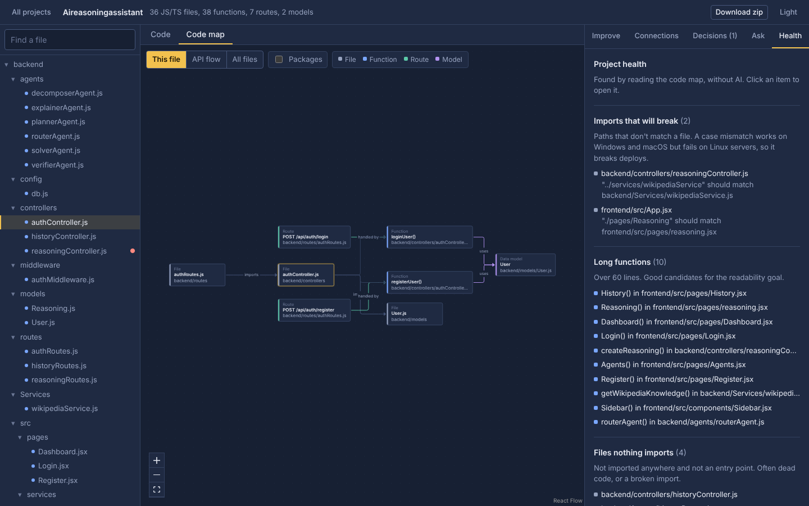
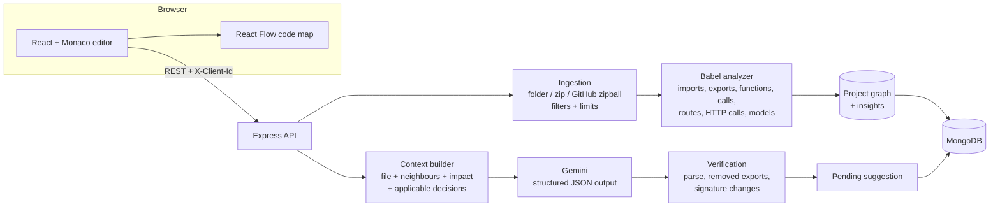

# Drafting Table: an AI code editor that knows your architecture

Most AI coding tools look at one file at a time. Drafting Table first builds a **code map** of the whole
project: which files import which, which functions call which, which frontend requests hit which backend
routes, and which functions touch which database models. Every AI suggestion is made with that map and
your recorded **architecture decisions** in view, and every suggestion is **checked automatically** before
you can accept it.



## What it does

- **Improve code by goal.** Pick readability, performance, security, maintainability, bug fixing, types and
  docs, or write your own goal. Improve a whole file or only the selected lines.
- **Review before anything changes.** Suggestions open in a diff view with a summary, a list of changes,
  a risk level and the files that might be affected. You can edit the suggestion before accepting it.
- **Automatic checks on AI output.** The backend re-parses the suggested code and blocks it if it doesn't
  parse, warns if it removes an export that other files import, and flags changed function signatures
  (including sync/async changes that need `await` in callers).
- **Code map.** Three views: the open file and everything connected to it, the full **API flow**
  (frontend function → route → handler → middleware → data model), and the import graph of all files.
- **Connections and impact.** For the open file: who uses it, what it depends on, the routes it defines and
  who calls them, the backend routes it calls, the models it uses, and a risk level for changing it.
- **Architecture memory.** Record decisions such as "controllers only call services". Each can apply to the
  whole project, a folder or a glob. Applicable decisions are sent with every suggestion, and the model
  reports whether it respected or conflicted with each one. Decisions can be suggested by the AI from the
  code map, or saved from an accepted change.
- **Project health, without AI.** Imports that will break on Linux because of letter case, import cycles,
  frontend requests that match no route, long functions, possibly unused exports and files nothing imports.
- **Ask questions** about the codebase, answered with the code map as context.
- **Import from a folder, a zip or a public GitHub repo.** Export the edited project as a zip.

| API flow | Connections for a file | Project health |
| --- | --- | --- |
|  |  |  |

## How it works



1. **Ingestion** (`backend/src/ingest`) keeps only source files, skips `node_modules`, build output, lock
   files, binaries and every `.env` file, rejects path traversal (`../`), and caps file count, file size and
   total size. Zips are decompressed with a hard output limit, so a zip bomb can't exhaust memory. GitHub
   repos are downloaded as a zipball from the GitHub API, so no `git` is needed on the server.
2. **Analysis** (`backend/src/analysis`) parses every JS/TS file with `@babel/parser` and connects the
   results: it resolves relative imports, `@/` aliases, `index` files and `export *` barrels; builds full
   Express route paths from `app.use("/api/x", router)` mounts; resolves `axios`/`fetch` URLs through
   constants such as `API_URL`, even when they are imported from another file; and matches them to backend
   routes. Insights use Tarjan's algorithm to find import cycles.
3. **Suggestions** (`backend/src/ai`) send Gemini the goal, the file, the files it imports and the files
   that import it, its connections from the map, and the decisions whose scope matches the file. The
   response is constrained to a JSON schema, then sanitized and verified before it is stored as a pending
   suggestion.
4. **Accepting** is guarded by optimistic locking: if the file changed after the suggestion was made, the
   accept is refused. Saving a file or accepting a change rebuilds the code map.

## Tech stack

| Layer | Tools |
| --- | --- |
| Frontend | React 19, Vite, Monaco Editor (bundled, no CDN), React Flow + dagre, react-markdown |
| Backend | Node.js, Express 5, Mongoose, Multer, adm-zip, Babel parser/traverse, express-rate-limit |
| AI | Google Gemini via `@google/genai`, structured JSON output |
| Data | MongoDB (Atlas), or an in-memory store for local tries and tests |
| Tests | Jest + Supertest: 90+ tests for analysis, ingestion, API flows and access control |

## Run it locally

You need Node.js 20 or newer.

```bash
# 1. Backend
cd backend
npm install
cp .env.example .env        # add GEMINI_API_KEY and MONGO_URI
npm run dev                 # http://localhost:5000

# No database yet? Try it with in-memory storage:
STORAGE=memory npm run dev

# 2. Frontend (new terminal)
cd frontend
npm install
npm run dev                 # http://localhost:5173 (proxies /api to the backend)
```

Get a free Gemini API key at [Google AI Studio](https://aistudio.google.com/apikey). Without a key the code
map, connections and health checks still work, and the AI features say they're off.

### Environment variables (backend)

| Variable | Required | Description |
| --- | --- | --- |
| `MONGO_URI` | yes (unless `STORAGE=memory`) | MongoDB connection string |
| `GEMINI_API_KEY` | for AI features | Google AI Studio API key |
| `GEMINI_MODEL` | no | Defaults to `gemini-3.8-flash` |
| `CORS_ORIGINS` | in production | Comma-separated frontend URLs allowed to call the API |
| `GITHUB_TOKEN` | no | Raises GitHub's download limit from 60 to 5000 requests per hour |
| `PORT` | no | Defaults to 5000 |

The frontend needs only `VITE_API_URL` in production (the backend's public URL).

## Tests

```bash
cd backend
npm test
```

The tests cover the analyzer on a realistic full-stack fixture (route mounting, barrels, aliases, request
matching, cycles, case-mismatched imports), ingestion limits and zip-bomb protection, GitHub URL parsing
and download limits, every API route including validation and stale-accept conflicts, access control
between clients, and the verification of AI output. Gemini and GitHub are replaced with fakes, so tests
run offline.

## Deploy

**Database:** create a free MongoDB Atlas cluster, add a database user, and allow access from anywhere
(`0.0.0.0/0`) so your host can connect. Copy the connection string.

**Backend on Render:** create a Web Service from the repo with root directory `backend`, build command
`npm install`, start command `npm start`, and health check path `/api/health`. Set `MONGO_URI`,
`GEMINI_API_KEY` and `CORS_ORIGINS` (your frontend URL). A `render.yaml` blueprint is included.

**Frontend on Vercel or Netlify:** root directory `frontend`, build command `npm run build`, output
directory `dist`, and set `VITE_API_URL` to the backend URL. Routing uses the URL hash, so no rewrite rules
are needed.

Render's free tier sleeps when idle, so the first request after a while can take about a minute.

## Security notes

- There are no accounts. Each browser gets a random ID stored in `localStorage` and sent as `X-Client-Id`.
  Every project lookup is filtered by it, so visitors can't list or open each other's projects. For real
  multi-user use, replace this with authentication.
- `.env` files are never stored, uploads are size-limited, AI and upload endpoints are rate-limited, and
  CORS is restricted with `CORS_ORIGINS`.
- Uploaded code is sent to the Gemini API when you ask for a suggestion or ask a question.

## API overview

All routes are under `/api` and, apart from `/health` and `/goals`, need an `X-Client-Id` header.

| Method | Route | Purpose |
| --- | --- | --- |
| POST | `/projects/folder`, `/projects/zip`, `/projects/github` | Create a project |
| GET / DELETE | `/projects`, `/projects/:id` | List, read or delete projects |
| GET / PUT | `/projects/:id/file?path=` | Read or save a file (with optimistic locking) |
| GET | `/projects/:id/graph`, `/projects/:id/impact?path=` | Code map and file impact |
| GET | `/projects/:id/export` | Download the project as a zip |
| POST | `/projects/:id/improve` | Get a goal-based suggestion |
| POST | `/projects/:id/improvements/:impId/accept` or `/reject` | Apply or discard it |
| POST | `/projects/:id/ask` | Ask a question about the code |
| GET / POST / PATCH / DELETE | `/projects/:id/decisions[/:decisionId]` | Architecture decisions |
| POST | `/projects/:id/decisions/suggest` | AI-suggested decisions (not saved) |

## Limitations and next steps

- The code map understands JavaScript and TypeScript. Other files can be viewed, edited and improved, but
  without connections or automatic checks.
- Request matching is static: URLs built at runtime from variables the analyzer can't see stay unmatched
  and are listed under Health.
- Ideas: accounts with JWT, private GitHub repos through OAuth, pushing accepted changes back as a pull
  request, running the project's own tests on a suggestion, and Python support for the code map.
